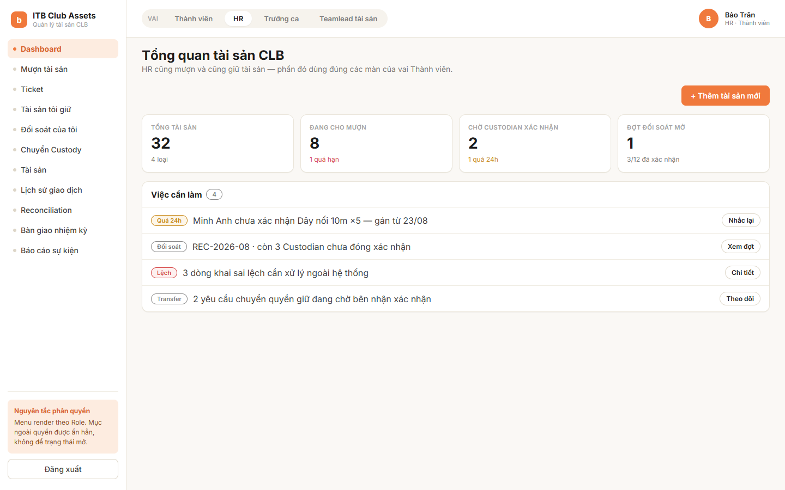
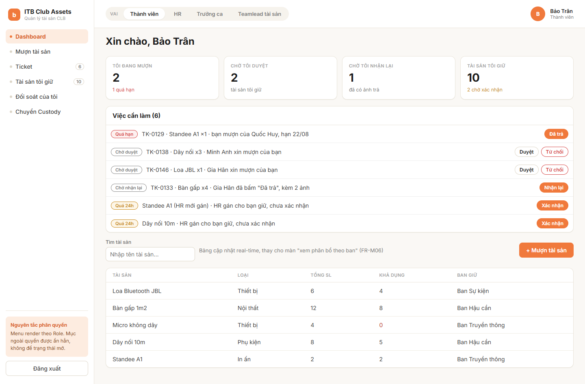
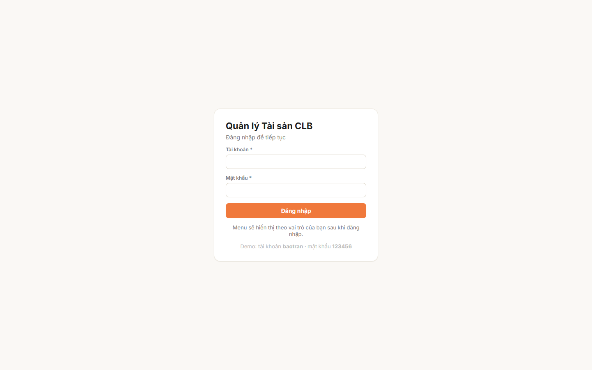
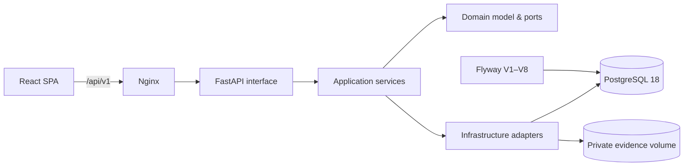

<div align="center">

# ITB Club Assets

### Asset Management System for student clubs

Theo dõi tài sản theo người giữ, quản lý mượn/trả, vận hành sự kiện, đối soát và
bàn giao nhiệm kỳ trên một nền tảng có lịch sử kiểm toán đầy đủ.

[](https://react.dev/)
[](https://vite.dev/)
[](https://fastapi.tiangolo.com/)
[](https://www.python.org/)
[](https://www.postgresql.org/)
[](https://docs.docker.com/compose/)
[](#quality)

[](https://github.com/nguyentthuy11work-dev/itb-club-assets/actions/workflows/ci.yml)
[](https://github.com/nguyentthuy11work-dev/itb-club-assets/actions/workflows/security.yml)
[](https://github.com/nguyentthuy11work-dev/itb-club-assets/actions/workflows/scorecard.yml)
[](LICENSE)

[Quick start](#quick-start) · [Architecture](#architecture) · [Quality](#quality) · [Contributing](CONTRIBUTING.md) · [Security](SECURITY.md)

</div>

<p align="center">
  
</p>

## Why this project?

Spreadsheet-based asset tracking cannot reliably answer who is holding an item,
how much is available, or whether a handover record has changed. ITB Club Assets
models those operations as explicit, auditable workflows with database-enforced
invariants and actor-scoped authorization.

## Highlights

| Module | Capability |
| --- | --- |
| **Assets & Custody** | Register assets, allocate quantities, track Responsible Team and confirm receipt with private photo evidence. |
| **Borrow Tickets** | Temporary loans or permanent Custodian changes, quantity reservation, approval, pickup and two-sided return. |
| **Event Operations** | Configure Event Days and ordered shifts, acknowledge opening inventory, close shifts and calculate carry-over. |
| **Reconciliation** | Immutable Custody snapshot, discrepancy evidence, HR resolution and a guarded close operation. |
| **Custody Transfer** | Either party may confirm first; the second confirmation performs one atomic Custody change. |
| **Term Handover** | Term-bound snapshot, stale-asset detection, dual HR confirmation, immutable lock and bounded CSV export. |
| **Reliability** | Idempotent commands, transactional outbox, retry-safe notifications, structured logs and trace IDs. |

<details>
<summary><strong>More UI previews</strong></summary>

### Member dashboard



### Login



</details>

## Quick start

### Prerequisite

Install [Docker Desktop](https://www.docker.com/products/docker-desktop/) with
Docker Compose v2:

```bash
docker compose version
```

### Start the complete system

From the repository root:

```bash
docker compose up --build -d
```

Compose automatically starts PostgreSQL, waits for it to become healthy, applies
all Flyway migrations, waits for the API readiness probe, then starts the web app.

| Service | URL |
| --- | --- |
| Web application | http://localhost:5173 |
| Backend API | http://localhost:8000 |
| Swagger UI | http://localhost:8000/docs |
| Liveness | http://localhost:8000/health |
| Readiness | http://localhost:8000/ready |

Demo credentials:

```text
Username: baotran
Password: 123456
```

Check status or follow logs:

```bash
docker compose ps
docker compose logs -f
```

Stop the system while keeping database volumes:

```bash
docker compose down
```

> `docker compose down -v` also deletes local database and evidence volumes. This
> cannot be undone.

## Architecture



The backend follows Clean Architecture:

```text
Interface (FastAPI routers)
        ↓
Application (use cases, DTOs, transactions)
        ↓
Domain (entities, policies, repository ABCs)
        ↑
Infrastructure (SQLAlchemy, AsyncPG, storage, notifications)
```

- Routers only parse requests, invoke use cases and map responses.
- Domain and Application layers do not depend on FastAPI or SQLAlchemy.
- Every repository has an abstract port and an infrastructure implementation.
- Flyway SQL is the only source of database schema changes.
- Business updates, idempotency records and outbox events commit atomically.

## Technology stack

| Area | Technology |
| --- | --- |
| Frontend | React 18, React Router, Vite 8 |
| Web server | Nginx 1.27 |
| API | Python 3.12, FastAPI, Pydantic v2 |
| Persistence | SQLAlchemy Async, AsyncPG, PostgreSQL 18 |
| Migration | Flyway 13, SQL-first migrations |
| Security | Argon2id, signed JWT, HttpOnly refresh cookie, object-level authorization |
| Observability | Structlog JSON logs, request trace IDs, health/readiness probes |
| Tooling | uv, Pytest, MyPy, Ruff, Black, Node test runner |
| Runtime | Docker Compose |

## Demo mode and real API mode

The default Compose build uses `VITE_USE_MOCK=true`. This gives reviewers a
complete UI walkthrough without inserting credentials or sample business data into
the real database. PostgreSQL, Flyway and FastAPI still start and remain available.

To connect the SPA to FastAPI:

```bash
cp .env.example .env
```

Set:

```dotenv
VITE_USE_MOCK=false
VITE_API_BASE_URL=/api/v1
```

Then rebuild:

```bash
docker compose up --build -d
```

Real API mode requires a provisioned user. Migrations intentionally seed role
definitions only and never create credentials.

## Local configuration

Creating `.env` is optional for demo mode. Available settings are documented in
`.env.example`:

```dotenv
WEB_PORT=5173
API_PORT=8000
POSTGRES_PORT=5432
POSTGRES_DB=ams
POSTGRES_USER=ams_app
POSTGRES_PASSWORD=ams_app_local
VITE_USE_MOCK=true
VITE_API_BASE_URL=/api/v1
```

All defaults are for local development only. Production deployments must supply
external secrets, TLS, secure cookies, immutable image tags, a notification worker,
monitoring and a tested backup/rollback procedure.

## Developer workflow

### Backend with hot reload

Requirements: Python 3.11+ and [uv](https://docs.astral.sh/uv/).

```bash
cd backend
cp .env.example .env  # if the file does not exist
docker compose up -d postgres
docker compose --profile tools run --rm flyway migrate
uv sync
uv run --env-file .env uvicorn ams.interface.api.main:create_app \
  --factory --reload --port 8000
```

### Frontend with hot reload

Requirement: Node.js 22+.

```bash
cd frontend
npm ci
npm run dev
```

## Quality

Current verified baseline:

- **309** backend unit, API and PostgreSQL integration tests.
- **100%** statement coverage across Domain and Application layers.
- **26** frontend contract tests.
- Repeated PostgreSQL race tests for reservation, idempotency, outbox claiming,
  Shift closing, Reconciliation, Transfer and Handover.
- Empty-database migration, repeated migration, backup and restore rehearsals.
- Zero known npm dependency advisories at the last verification.

Run the same local gates:

```bash
cd backend
uv run black --check src tests
uv run ruff check src tests
uv run mypy src tests
uv run --env-file .env pytest
```

```bash
cd frontend
npm test
npm run build
npm audit
```

GitHub Actions runs backend checks against PostgreSQL 18, enforces 100% coverage,
tests/builds the frontend and verifies both Docker images.

Additional repository automation includes CodeQL analysis, secret scanning,
pull-request dependency review, OpenSSF Scorecard, Dependabot, pre-commit hooks
and automatically prepared release notes.

## Repository layout

```text
.
├── .github/
│   ├── assets/              # README screenshots
│   ├── workflows/ci.yml     # Backend, frontend and container CI
│   └── dependabot.yml
├── backend/
│   ├── migrations/          # Immutable Flyway SQL migrations
│   ├── openapi/             # Canonical API examples
│   ├── src/ams/
│   │   ├── domain/
│   │   ├── application/
│   │   ├── infrastructure/
│   │   └── interface/api/
│   └── tests/               # Unit, API and PostgreSQL integration tests
├── frontend/
│   ├── src/api/             # Client, DTO mappers and contract tests
│   ├── src/components/
│   └── src/pages/
├── compose.yaml
└── README.md
```

## Troubleshooting

<details>
<summary><strong>A port is already in use</strong></summary>

Create `.env` and change one or more host ports:

```dotenv
WEB_PORT=5174
API_PORT=8001
POSTGRES_PORT=5433
```

</details>

<details>
<summary><strong>Docker is exposed as docker.exe in WSL</strong></summary>

Use the same commands with `docker.exe`:

```bash
docker.exe compose up --build -d
```

</details>

<details>
<summary><strong>The backend is not ready</strong></summary>

```bash
docker compose ps
docker compose logs migrate backend
```

</details>

<details>
<summary><strong>Reset local data</strong></summary>

```bash
docker compose down -v
docker compose up --build -d
```

Only reset when local data is no longer needed.

</details>

---

<div align="center">
Built as an auditable, concurrency-safe alternative to spreadsheet asset tracking.

[Contributing](CONTRIBUTING.md) · [Security policy](SECURITY.md) · [Code of conduct](CODE_OF_CONDUCT.md) · [MIT license](LICENSE)
</div>
